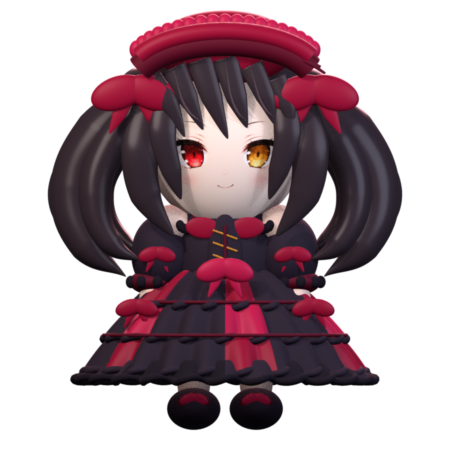
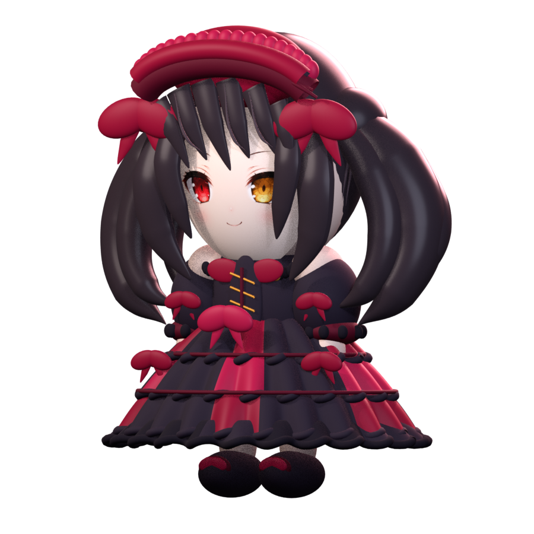
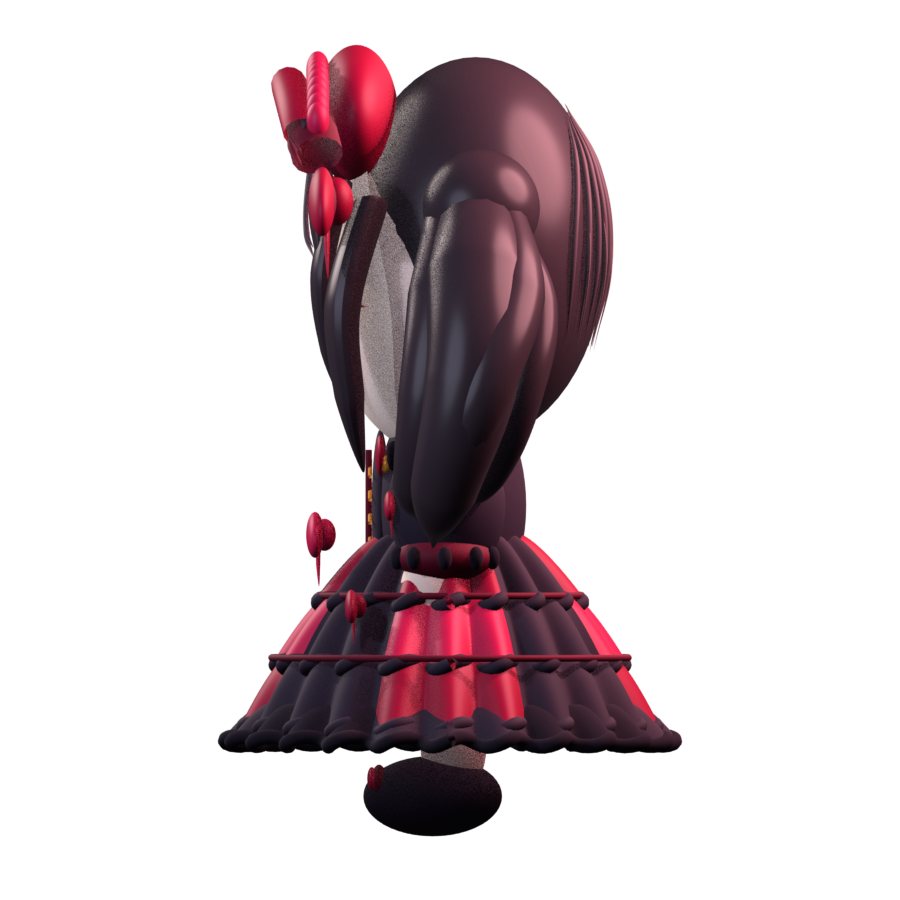
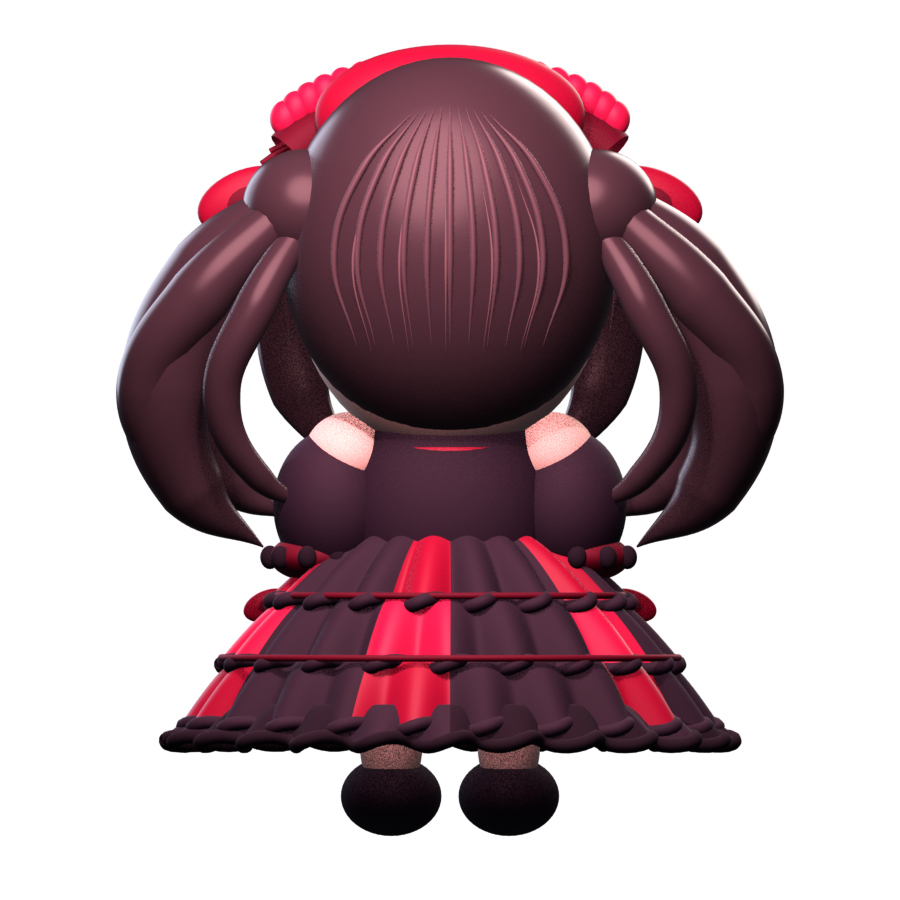

# DSH 时崎狂三桌宠（macOS）

这是单独维护的狂三桌宠扩展项目，GitHub 仓库不属于 fork。它把狂三透明动作帧接到 DSH 大肥鱼插件的状态协议与 macOS 原生 Helper 上；需要另行安装官方 [QCYTSN/dsh-dafeiyu](https://github.com/QCYTSN/dsh-dafeiyu)。原作者和贡献者保有原项目代码及功能的署名。

桌宠待机保持静止；点击互动或 DSH 状态事件才播放一次动作，结束回到待机。旧的待机、思考和工作循环帧不再自动播放。DSH 的“减少动态效果”会冻结环境循环帧，但保留点击和状态事件触发的单次动作。三种点击互动都放慢到 240ms/帧，结束回到待机。它们是透明关键姿势序列，不是完整 24fps 视频。狂三没有动物尾巴。

| 待机 | 思考 / 等待 |
| --- | --- |
|  |  |

| 翻书工作 | 开心招手 |
| --- | --- |
|  |  |

| 新版分段招手（入场 → 主体 → 收势回待机） |
| --- |
|  |

| 摸头回应 | 戳击回应 | 整理发带 |
| --- | --- | --- |
|  |  |  |

前两段 GIF 是早期动作示例；发带 v2 预览与当前 9 帧单次动作一致。桌宠待机仍保持静止，点击发饰才播放。详细来源见 [动画素材记录](extras/kurumi-animation/generated/README.md)、[Windows 动作参考](extras/kurumi-animation/windows-action-port.md) 与 [NOTICE](NOTICE.md)。

## Blender 3D 模型 v3

按已确认的狂三 Q 版桌宠比例制作了可编辑 3D 模型：大头短身、黑色双马尾、红黑发饰、短裙与小腿。当前交付是模型评审版；桌宠启动器仍使用现有 2D 皮肤，3D 模型接入和动作绑定是后续工作。

| 正面 | 四分之三视角 |
| --- | --- |
|  |  |

| 侧面 | 背面 |
| --- | --- |
|  |  |

工程文件为 [`kurumi-v3.blend`](assets/kurumi3d/v3/kurumi-v3.blend)，通用模型为 [`kurumi-v3.glb`](assets/kurumi3d/v3/kurumi-v3.glb)，macOS 模型导入包为 [`kurumi-v3.usdz`](assets/kurumi3d/v3/kurumi-v3.usdz)。模型由项目内的 `build_kurumi_v3.py` 生成；细节和素材来源见 [v3 模型说明](assets/kurumi3d/v3/README.md)。

## 安装

需要 macOS 12+、Node.js 和 Xcode Command Line Tools。先完全退出 DSH Host，再在本项目根目录运行：

```sh
# Web profile 默认位置；桌面 profile 可将此变量改为对应插件目录
export DSH_DAFEIYU_ROOT="$HOME/.dsh/profiles/web/node_modules/dsh-dafeiyu"

native/macos/build-helper.sh
scripts/install-helper.sh
node extras/kurumi-skin/install-skin.mjs --dry-run
node extras/kurumi-skin/install-skin.mjs
```

重新启动 DSH Host 后生效。`install-helper.sh` 会把旧 Helper 移到 `~/.dsh/dsh-dafeiyu/backups/`；安装器会备份原 `skin.json`，旧皮肤目录保留。脚本不会结束 DSH 进程，也不读取或更改模型凭据。

只想预览安装配置时，运行带 `--dry-run` 的命令即可。要恢复旧版，可退出 DSH，将备份 Helper 移回插件目录，并恢复 `skin.json` 备份后重启。

## 项目边界

- DSH 大肥鱼插件负责会话事件；本项目提供 macOS Helper 的狂三动作适配和皮肤素材。
- Helper 代码基于原 DSH 桌宠实现；本仓库没有复制大肥鱼角色帧。
- 这是透明关键帧方案，不是 Live2D 或 Windows 版的 100 段动作库。
- 时崎狂三属于《约会大作战》角色；相关图片为非官方同人素材，素材说明见 [ASSET_LICENSE.md](ASSET_LICENSE.md)。
- 自动循环已关闭；交互动作仍使用旧关键姿势序列，24fps 透明视频替换尚未完成。
- Blender v3 已完成可编辑模型与四视角样图；尚未替换到桌宠启动器，也未完成 3D 骨骼动画。

## 来源

主体项目：**QCYTSN 及贡献者**，[dsh-dafeiyu](https://github.com/QCYTSN/dsh-dafeiyu)。Windows 动作状态与交互节奏参考 **dsqrwym 和 FeiYu contributors** 的 [DaFeiYu-Desktop-Pet](https://github.com/dsqrwym/DaFeiYu-Desktop-Pet)；未复制其角色图帧。
