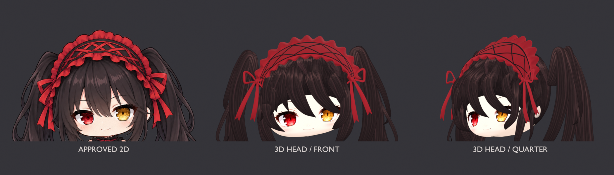

# DSH 时崎狂三桌宠（macOS）

这是单独维护的狂三桌宠扩展项目，GitHub 仓库不属于 fork。它把狂三透明动作帧接到 DSH 大肥鱼插件的状态协议与 macOS 原生 Helper 上；需要另行安装官方 [QCYTSN/dsh-dafeiyu](https://github.com/QCYTSN/dsh-dafeiyu)。原作者和贡献者保有原项目代码及功能的署名。

桌宠待机保持静止；点击互动或 DSH 状态事件才播放一次动作，结束回到待机。旧的待机、思考和工作循环帧不再自动播放。DSH 的“减少动态效果”会冻结环境循环帧，但保留点击和状态事件触发的单次动作。三种点击互动都放慢到 240ms/帧，结束回到待机。它们是透明关键姿势序列，不是完整 24fps 视频。狂三没有动物尾巴。

## 当前建模预览：v8 头部小样

下面依次为已确认的 2D 参考、v8 正面渲染、v8 斜侧渲染。首页已撤下早期动作 GIF 和 v3 示例图，当前仅展示这一版建模进度。



本轮调整了眼睛与脸部比例、分层刘海和卷梢、交叉发带及镂空蝴蝶结，并加入独立的发丝纹理。模型为有厚度的三维网格；上图中的模型画面均来自 Blender 实际渲染。

**这仍是未定稿的头部研究，尚未得到造型认可。** 侧面发饰和发根层次还需改进；本轮未完成全身、绑定或动作，也没有替换正在运行的 2D 桌宠。

[查看正面](assets/kurumi3d/v8/front.png) · [查看斜侧面](assets/kurumi3d/v8/quarter.png) · [查看侧面](assets/kurumi3d/v8/side.png) · [查看灰模](assets/kurumi3d/v8/clay-quarter.png)

[下载 Blender 工程](assets/kurumi3d/v8/kurumi-head-study.blend) · [建模源脚本、检查结果与素材出处](assets/kurumi3d/v8/README.md)

历史动作素材仍作为现有 2D 功能的资源保留，详细记录见[动画素材说明](extras/kurumi-animation/generated/README.md)与 [Windows 动作参考](extras/kurumi-animation/windows-action-port.md)。

## 安装

需要 macOS 12+、Node.js 和 Xcode Command Line Tools。先完全退出 DSH Host，再在本项目根目录运行：

```sh
# Web profile 默认位置；桌面 profile 可将此变量改为对应插件目录
export DSH_DAFEIYU_ROOT="$HOME/.dsh/profiles/web/node_modules/dsh-dafeiyu"

native/macos/build-helper.sh
scripts/install-helper.sh
node extras/kurumi-skin/install-skin.mjs --dry-run
node extras/kurumi-skin/install-skin.mjs
```

重新启动 DSH Host 后生效。`install-helper.sh` 会把旧 Helper 移到 `~/.dsh/dsh-dafeiyu/backups/`；安装器会备份原 `skin.json`，旧皮肤目录保留。脚本不会结束 DSH 进程，也不读取或更改模型凭据。

只想预览安装配置时，运行带 `--dry-run` 的命令即可。要恢复旧版，可退出 DSH，将备份 Helper 移回插件目录，并恢复 `skin.json` 备份后重启。

## 项目边界

- DSH 大肥鱼插件负责会话事件；本项目提供 macOS Helper 的狂三动作适配和皮肤素材。
- Helper 代码基于原 DSH 桌宠实现；本仓库没有复制大肥鱼角色帧。
- 这是透明关键帧方案，不是 Live2D 或 Windows 版的 100 段动作库。
- 时崎狂三属于《约会大作战》角色；相关图片为非官方同人素材，素材说明见 [ASSET_LICENSE.md](ASSET_LICENSE.md)。
- 自动循环已关闭；交互动作仍使用旧关键姿势序列，24fps 透明视频替换尚未完成。
- 当前展示 v8 头部建模小样；尚未完成全身与绑定，也未接入桌宠启动器。

## 来源

主体项目：**QCYTSN 及贡献者**，[dsh-dafeiyu](https://github.com/QCYTSN/dsh-dafeiyu)。Windows 动作状态与交互节奏参考 **dsqrwym 和 FeiYu contributors** 的 [DaFeiYu-Desktop-Pet](https://github.com/dsqrwym/DaFeiYu-Desktop-Pet)；未复制其角色图帧。
