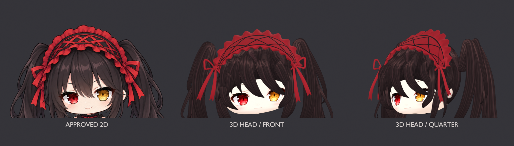

# DSH Kurumi Desktop Pet for macOS

This is a separately maintained Kurumi add-on repository; it is not a GitHub fork. It connects Kurumi's transparent animation frames to the DSH BigFish plugin's state protocol and native macOS Helper. Install the upstream [QCYTSN/dsh-dafeiyu](https://github.com/QCYTSN/dsh-dafeiyu) separately. Its authors retain credit for the original project code and features.

The pet stays still at idle. A click or DSH status event plays one action once, then returns to idle. The old idle, thinking, and working loops no longer autoplay. DSH's Reduced Motion setting freezes ambient loops while preserving click and status-triggered one-shots. All three click responses now use 240 ms per pose before returning to idle. They are transparent key-pose sequences, not complete 24 fps videos. Kurumi has no animal tail; touching the hair accessory triggers the one-shot response.

## Current modeling preview: v8 head study

Left to right: the approved 2D reference, the v8 front render, and the v8 three-quarter render. Earlier animation GIFs and v3 review images have been removed from the homepage preview.



This iteration revises the face and eye proportions, layered bangs and curled tips, crossed bonnet ribbons, open ribbon loops, and dedicated hair albedo. The head is volumetric mesh geometry; all model images above are actual Blender renders.

**This is an unapproved head-only study.** The side silhouette, headpiece, and hair roots still need improvement. There is no completed body, rig, or character animation. An optional native 3D head preview is now available; it stays still until a view change or one slow rotation is requested.

[Front](assets/kurumi3d/v8/front.png) · [Three-quarter](assets/kurumi3d/v8/quarter.png) · [Side](assets/kurumi3d/v8/side.png) · [Clay geometry view](assets/kurumi3d/v8/clay-quarter.png)

[Download the Blender project](assets/kurumi3d/v8/kurumi-head-study.blend) · [Build scripts, validation, and provenance](assets/kurumi3d/v8/README.md)

Historical 2D animation assets remain available for the existing runtime. See the [animation asset log](extras/kurumi-animation/generated/README.md) and [Windows action mapping](extras/kurumi-animation/windows-action-port.md).

## Install

Requires macOS 12+, Node.js, and Xcode Command Line Tools. Fully quit the DSH Host, then run from this repository root:

```sh
export DSH_DAFEIYU_ROOT="$HOME/.dsh/profiles/web/node_modules/dsh-dafeiyu"

native/macos/build-helper.sh
scripts/install-helper.sh
node extras/kurumi-skin/install-skin.mjs --dry-run
node extras/kurumi-skin/install-skin.mjs
```

Restart DSH to apply. The installer backs up the previous Helper under `~/.dsh/dsh-dafeiyu/backups/` and saves the previous `skin.json`; older skin folders remain available. The scripts do not stop DSH or read or change model credentials.

To roll back, quit DSH, move the backed-up Helper back into the plugin directory, restore the `skin.json` backup, and restart.

## Enable the v8 desktop head preview

Quit DSH (or turn off its pet switch) before installing and selecting the new renderer. After installing the Helper and skin above, run:

```sh
node scripts/enable-v8-head.mjs --dry-run
node scripts/enable-v8-head.mjs
```

Restart DSH. Double-click or right-click the head for front, three-quarter, side, and back views, or an eight-second single rotation. Idle is stationary, and every view transition ends at rest. Walking and waving are omitted because this study has no body or rig.

The previous 2D configuration remains available by switching off the v8 head mode in the menu. The selection script backs up `skin.json` before changing the renderer; it does not change chat models or credentials. See the [runtime notes](assets/kurumi3d/v8/RUNTIME.md).

## Scope

- The DSH BigFish plugin provides session events; this project supplies the macOS Helper adaptation and Kurumi skin.
- Helper code is derived from the original DSH desktop pet. This repository does not copy BigFish character frames.
- This is a transparent keyframe solution, not Live2D or the Windows version's 100-clip library.
- Tokisaki Kurumi is a character from *Date A Live*. The pictures are unofficial fan art; see [ASSET_LICENSE.md](ASSET_LICENSE.md).
- Autoplay loops are disabled. The ribbon response has a new nine-pose sequence; other click responses still use the earlier sparse poses. None is a finished 24 fps transparent video.
- The current preview is the v8 head study, with optional native desktop viewing. A complete body, rig, and character actions remain unfinished.

## Sources

Original project: **QCYTSN and contributors**, [dsh-dafeiyu](https://github.com/QCYTSN/dsh-dafeiyu). Windows action categories and interaction timing reference **dsqrwym and FeiYu contributors**, [DaFeiYu-Desktop-Pet](https://github.com/dsqrwym/DaFeiYu-Desktop-Pet); no BigFish character frames are included.
