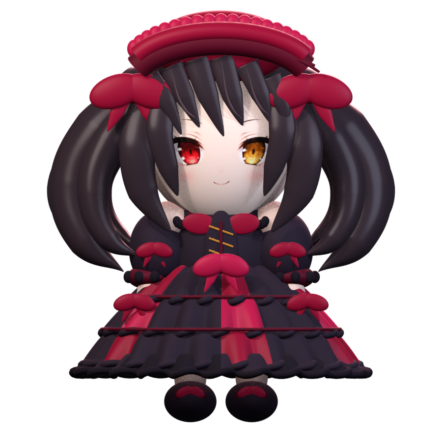
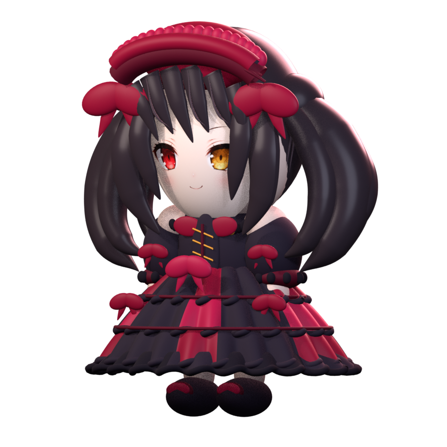
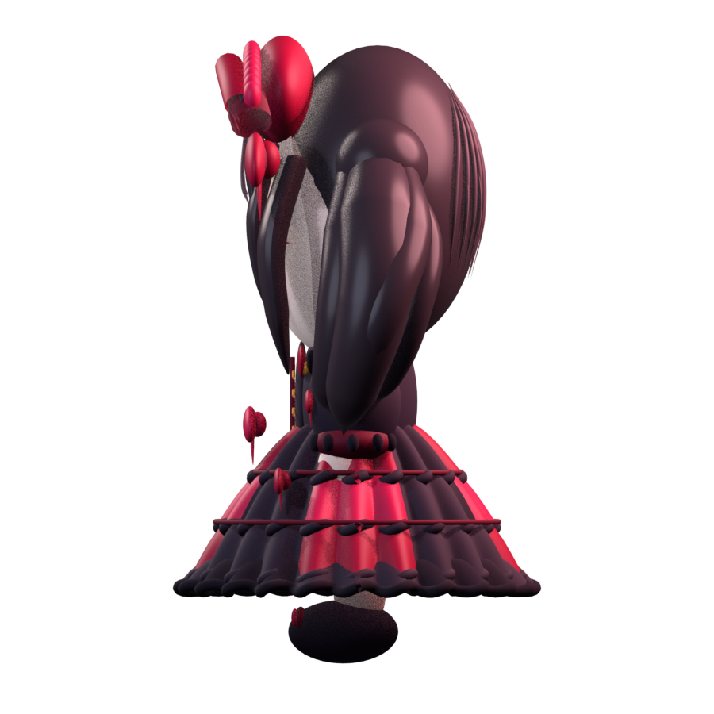

# Kurumi 3D Model v3

Editable Blender model created for the DSH Kurumi companion. The current stage focuses on the model and silhouette; it is not yet wired into the desktop helper and does not include a character rig or 3D action clips.

## Review views

| Front | Three-quarter |
| --- | --- |
|  |  |

| Side | Back |
| --- | --- |
|  |  |

## Files

- `kurumi-v3.blend` — editable Blender scene, with separate named meshes and curves.
- `kurumi-v3.glb` — portable glTF model for review and interchange.
- `kurumi-v3.usdz` — USDZ package exported for a possible macOS Model I/O / SceneKit integration.
- `build_kurumi_v3.py` — procedural geometry and preview render source.
- `front.png`, `quarter.png`, `side.png`, `back.png` — transparent-background inspection renders.

To regenerate, open `build_kurumi_v3.py` in Blender's Text Editor and choose **Run Script**. The script writes the project files and renders beside itself. The Blender scene contains the editable geometry, including the head, face shell, bangs, twin-tail locks, bonnet, bodice, sleeves, layered skirt, shoes, camera, and lights.

## Proportion and design notes

The approved Kurumi desktop-pet chibi is the proportion guide: large rounded head, compact torso, short visible legs, broad layered skirt, black twin tails, and red-black gothic clothing. There is no animal tail. The face uses the existing project `v2/face.png` texture so the ruby viewer-left eye, amber clock viewer-right eye, and smile stay consistent with the approved portrait. The remaining forms are newly modeled geometry for this companion project.

## Attribution and rights

The macOS helper and DSH integration retain the upstream credit for **QCYTSN and contributors**; Windows action categories and pacing reference **dsqrwym and FeiYu contributors**. Neither project's character image frames are included in this model. See the repository [NOTICE](../../../NOTICE.md), [ASSET_LICENSE](../../../ASSET_LICENSE.md), and v2 [texture provenance](../v2/PROVENANCE.md).

Tokisaki Kurumi and *Date A Live* belong to their respective rights holders. This is unofficial fan work based on the user's approved reference image; the project does not claim ownership of the character.
