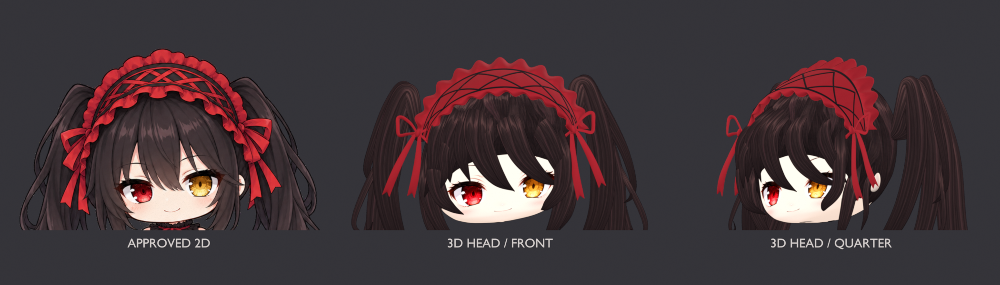

# 狂三头部建模小样 v8

这是公开保存的静态头部建模小样，尚未得到用户认可，不是定稿。桌宠仍使用现有 2D 版本；本次没有替换桌宠或新增动作。

## 本轮范围

- 重新校准眼距、眼线倾斜和短下脸，缩小上一版过宽的可见脸部。
- 根据当前 2D 参考的关键位置，重排中央刘海、长短鬓发和独立卷梢。
- 发束采用有厚度的闭合网格；头部有完整侧面与后脑体积。
- 发带改为正面可见的大交叉织带，褶边向后弯折贴合头顶。
- 使用独立发丝纹理，避免把参考图里的蝴蝶结和其他发束轮廓投到模型上。

## 文件

- `kurumi-head-study.blend`：独立可编辑头部场景，所用图片已打包。
- `front.png`、`quarter.png`、`side.png`：Blender 实际渲染。
- `clay-quarter.png`：不使用彩色贴图的几何检查图。
- `comparison.png`：原图、实际正面渲染、实际斜侧渲染的同尺度头部对照。只做展示裁切，不修饰渲染图；对照用的平面不属于模型场景。
- `model-check.json`：实际网格检查结果。
- `build.py`、`bonnet.py`、`hair_bow.py`：建模与渲染源脚本。
- `mesh_helpers.py`：随本目录附带的基础网格助手，由本项目前期研究脚本提取，没有外部底模依赖。
- `compare.py`：使用实际渲染输出和已确认 2D 原图生成对照。
- `finalize.py`：重渲染、生成对照并重新打开独立模型。
- `open_model_view.py`：文件打开后，在新控制台调用中验证素材打包，并保存可旋转查看的视口。

## 查看与重新生成

直接使用 Blender 4.5 LTS 打开 `kurumi-head-study.blend` 即可查看；模型使用的纹理已打包，无需运行脚本。文件内的旧本机素材路径属于制作时元数据，打包图像不依赖这些路径。

若要重新生成，请下载完整仓库，保留本目录及下方列出的两份项目内参考素材。先保存当前 Blender 工作，再在 Blender 的 Python 控制台运行（替换为实际仓库路径）：

```python
import runpy
runpy.run_path('/path/to/dsh-kurumi-companion/assets/kurumi3d/v8/finalize.py', run_name='__main__')
```

该脚本会覆盖本目录中的模型、预览图和检查报告，并打开重新生成的独立模型。文件加载完毕后，在新的控制台调用中运行 `open_model_view.py`，完成重新打开后的检查和视口保存。路径由脚本位置解析，无需本机旧工作目录或 v7 文件。

`build.py` 第一次运行会在本目录备份当前 Blender 会话为 `before-v8-session.blend`；这是本机工作备份，不属于公开模型资产，已在本目录 `.gitignore` 中排除。请勿将该文件上传。

## 素材出处与制作说明

- 人物造型：用户选择的项目现有 [已确认 2D 参考](../../../extras/kurumi-animation/reference/idle-approved.png)。
- 脸部纹理：项目现有 [v2 face.png](../v2/face.png)；本轮只调整 3D UV 映射。
- `hair-albedo.png`：本轮使用内置 imagegen 工具生成的专用头发颜色纹理，不是模型预览图。
- 时崎狂三为《约会大作战》角色，本小样为角色同人研究；没有把角色设定声明为原创。
- 本轮未采用任何外部下载的底模。几何、UV 调整、发带和镂空蝴蝶结由本项目建模脚本生成；发丝颜色纹理由内置 imagegen 工具辅助制作。
- 桌宠主体来源仍为 **QCYTSN 及贡献者**的 [dsh-dafeiyu](https://github.com/QCYTSN/dsh-dafeiyu)；Windows 动作参考为 **dsqrwym 和 FeiYu contributors** 的 [DaFeiYu-Desktop-Pet](https://github.com/dsqrwym/DaFeiYu-Desktop-Pet)。本目录没有复制大肥鱼模型或角色动画素材。
- 代码和角色素材的权利范围不同，见仓库 [NOTICE](../../../NOTICE.md) 与 [ASSET_LICENSE](../../../ASSET_LICENSE.md)。

### 发丝纹理生成提示词

Use case: stylized-concept. Asset type: 3D anime hair UV albedo texture, opaque rectangular flat texture. Generate a seamless full-frame hand-painted dark charcoal-brown anime hair texture, appropriate for a finely illustrated chibi gothic anime girl. This is ONLY a material texture swatch, not a character or object. The entire square must be filled with hair fibres, zero background or padding. All fibres flow vertically from top to bottom, nearly straight, slightly organic with thin alternating dark lines and softly painted charcoal, warm gray-brown, restrained plum-brown streaks. Match dark brown-black anime hair, not blonde, gray, glossy plastic, fur, or realistic macro hair. Fine brushwork, a few medium-width strands plus very fine linework. Subtle muted warm taupe anime specular streaks in one broken jagged horizontal band at the upper third, never white. Overall very dark (sRGB roughly #292327 base, #504048 muted highlights), bottom darker, no sharp bright stripes. No face, eyes, ears, forehead, skin, ribbons, bow, cloth, ornaments, text, diagram, watermark or human silhouette. Texture runs to all four edges, seamless horizontally, flat orthographic albedo with no perspective. Output one 1024x1024 square texture.

## 预览



[正面](front.png) · [斜侧面](quarter.png) · [侧面](side.png) · [灰模检查](clay-quarter.png)

## 尚未完成

这仍是头部小样。服装、全身比例、绑定和动作不在本轮交付范围；侧面发帽、发根层次和布料细节仍有明显改进空间，不能视为与原画等质的定稿。

当前文件已重新打开验证：头部网格没有非流形边，模型使用的两张纹理均已打包，模型场景不含对照用图片平面。正面、斜侧、侧面和灰模均已实际渲染并检查。
